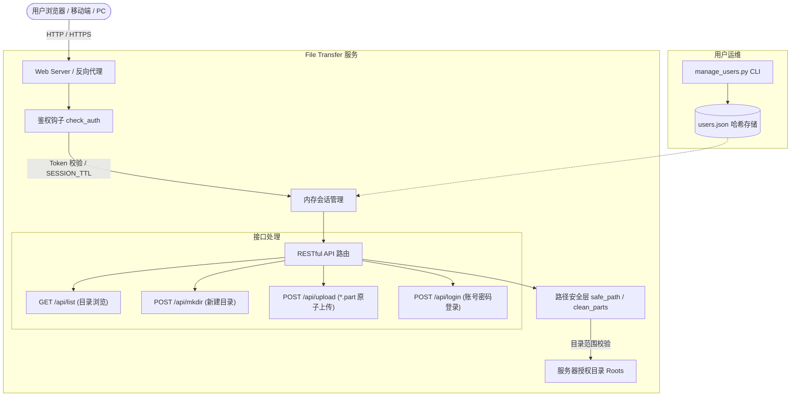

# File Transfer: 轻量级局域网文件传输与投递服务

<p align="center">
  
  
  
  
</p>

> **File Transfer** 是一款**零前端依赖、单文件极简后端**的轻量级局域网/私有文件上传与投递服务。通过浏览器即可在服务器授权目录下进行文件浏览、多级目录创建、单/多文件及整文件夹批量拖拽上传，并提供多用户角色鉴权与目录隔离机制。

---

## 🌟 核心特性

- 🚀 **极简轻量，零构建依赖**：
  - 后端仅依赖 `Flask`，核心逻辑集中于单文件。
  - 前端采用原生 HTML5 + CSS3 + Vanilla JavaScript，无 Node.js、Vue、React 等重型打包链，开箱即用。
- 🔐 **多用户与精细化权限隔离**：
  - 支持 `admin`（读写、新建目录、文件上传）与 `viewer`（只读浏览）两种角色。
  - 每个用户支持绑定各自独立的可访问根目录列表（`roots`），严禁跨目录越权访问。
  - 密码使用 `Werkzeug` 安全哈希（scrypt）存储，杜绝明文泄露。
- 📂 **全功能上传体验**：
  - **多样化上传方式**：支持文件选择、文件夹选择（`webkitdirectory`）以及拖拽上传（直接拖拽到工作区或特定子目录行）。
  - **原子写入机制**：上传过程中先写入 `*.part` 临时分片，传输完成后原子替换（`os.replace`），防止网络波动产生半截损坏文件。
  - **智能冲突防护**：同名文件默认保护不覆盖（HTTP 409），支持网页端勾选覆盖开关。
  - **并发队列与进度可视化**：前端维护最大并发数为 3 的上传队列，实时展示百分比进度条与状态。
- 🛡️ **严格的目录穿越防护**：
  - 内置 `clean_parts` 规范化过滤，阻断 `..`、空字节与绝对路径注入。
  - 采用 `safe_path` 严格比对解析后的绝对路径，确保严格限制在授权根目录内部。
- 🔄 **高可用守护支持**：
  - 内置保活守护脚本（`keep_alive.sh`），兼容 DolphinScheduler 定时调度与系统 Crontab。

---

## 📐 架构设计



---

## 📁 目录结构

```text
file_transfer/
├── .env.example              # 环境变量配置模板
├── .gitignore                # Git 忽略规则 (过滤日志/PID/真实密码等)
├── CONTRIBUTING.md           # 开源贡献指南
├── LICENSE                   # MIT 开源许可证
├── PRD.md                    # 完整产品需求设计文档
├── README.md                 # 项目说明文档
├── requirements.txt          # Python 依赖清单
├── start.sh                  # 一键启动脚本 (自动探测环境与配置)
└── file_transfer/            # 服务核心代码包
    ├── app.py                # 后端主应用 (Flask API 与路由)
    ├── manage_users.py       # 用户管理 CLI 脚本 (增删改查)
    ├── keep_alive.sh         # 进程保活与自动拉起脚本
    ├── users.example.json    # 用户配置示例模板
    └── static/               # 前端静态资源
        ├── index.html        # 单页面前端应用 (HTML/CSS/JS)
        └── bg.png            # 页面背景静态图
```

---

## 🚀 快速上手

### 1. 环境准备

确保已安装 **Python 3.8+**。克隆本仓库并安装依赖：

```bash
git clone https://github.com/<your-username>/file_transfer.git
cd file_transfer

# 安装依赖
pip install -r requirements.txt
```

### 2. 初始化用户账号

File Transfer 支持多用户及目录权限划分。首次使用需通过 `manage_users.py` 创建账号：

```bash
# 用法: python file_transfer/manage_users.py add <用户名> <密码> <角色 admin|viewer> <可访问根目录(逗号分隔)>

# 示例 1: 创建管理员账号 (拥有读写权限)
python file_transfer/manage_users.py add admin "Admin@123" admin /data/shared

# 示例 2: 创建只读访客账号 (仅可浏览，不可上传/新建)
python file_transfer/manage_users.py add guest "Guest@123" viewer /data/shared/public
```

> [!TIP]
> 配置文件默认保存在 `file_transfer/users.json`，已被 `.gitignore` 忽略，不会随 Git 提交。

### 3. 启动服务

#### 方式 A：使用一键启动脚本（推荐）
```bash
./start.sh
```
脚本会自动探测系统/Conda/venv 中的 Python 解释器，校验配置文件，并打印本机与局域网访问地址。

#### 方式 B：直接通过 Python 启动
```bash
python file_transfer/app.py
```

服务默认在 `http://0.0.0.0:18000` 启动，打开浏览器即可进入登录界面。

---

## ⚙️ 环境变量配置

可通过环境变量或 `.env` 自定义启动参数：

| 变量名 | 说明 | 默认值 |
| --- | --- | --- |
| `HOST` | 服务监听的 IP 地址 | `0.0.0.0` |
| `PORT` | 服务监听端口 | `18000` |
| `USERS_FILE` | 用户账号与权限配置文件路径 | `./users.json` |
| `SESSION_TTL` | 登录会话有效期（秒） | `43200`（12小时） |

示例：
```bash
PORT=8080 USERS_FILE=/etc/file_transfer/users.json python file_transfer/app.py
```

---

## 👥 用户与权限管理命令

通过 `manage_users.py` 可以方便地在终端维护账号信息：

```bash
# 1. 列出所有用户及其权限
python file_transfer/manage_users.py list

# 2. 添加或更新用户
python file_transfer/manage_users.py add <用户名> <密码> <角色: admin|viewer> <授权目录1,目录2>

# 3. 修改用户密码
python file_transfer/manage_users.py passwd <用户名> <新密码>

# 4. 删除用户
python file_transfer/manage_users.py del <用户名>
```

---

## 🛠️ 生产部署与进程保活

### 方案 1：DolphinScheduler / Crontab 守护脚本

仓库内置了精准端口与进程双重探测的守护脚本 `keep_alive.sh`：

```bash
# 手动执行测试
bash file_transfer/keep_alive.sh

# crontab 配置每分钟检查一次保活 (示例)
* * * * * bash /path/to/file_transfer/file_transfer/keep_alive.sh >> /path/to/cron.log 2>&1
```

- 若服务正常监听端口，脚本静默退出；
- 若进程异常退出或端口掉线，脚本会自动清理残留 PID 并重启服务。

### 方案 2：Systemd 系统服务

创建 `/etc/systemd/system/file-transfer.service`：

```ini
[Unit]
Description=File Transfer Service
After=network.target

[Service]
Type=simple
User=your_user
WorkingDirectory=/path/to/file_transfer/file_transfer
ExecStart=/usr/bin/python3 app.py
Restart=always
RestartSec=3
Environment="PORT=18000"

[Install]
WantedBy=multi-user.target
```

激活并启动服务：
```bash
sudo systemctl daemon-reload
sudo systemctl enable --now file-transfer
```

---

## 🔒 安全性设计说明

1. **路径穿越防御（Path Traversal Prevention）**：
   - 统一将客户端提交路径的 `\` 转为 `/`，拒绝包含 `..`、空字符或前导 `/` 的相对路径。
   - 所有目标路径经过 `Path.resolve()` 计算后，严格校验 `root in target.parents or target == root`。
2. **密码哈希与防爆破**：
   - 密码使用 Werkzeug 基于 scrypt 的强哈希单向加密，服务不会明文保存密码。
   - 会话采用 `secrets.token_urlsafe(32)` 生成高熵随机 Token，内存定时失效。
3. **数据完整性保障**：
   - 避免上传中断导致垃圾损坏文件留存，所有上传采用 `dest.name + ".part"` 临时写入，传输完毕后使用操作系统级别原子替换（`os.replace`）。

---

## 📄 许可证

本项目遵循 [MIT License](LICENSE) 开源许可协议。欢迎自由分发与商业应用。
